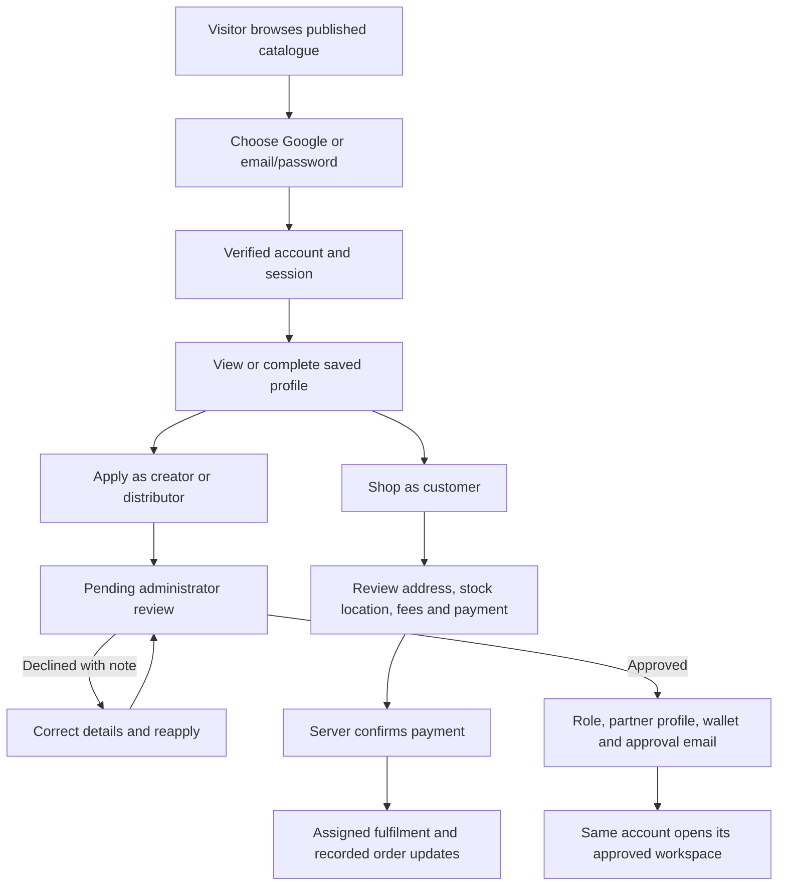

# User journeys and workflow audit

Reviewed 30 October 2026. This review covers the customer, creator, distributor and administrator paths in the root storefront and the backend storefront. It preserves the existing portals and checks their data sources, transitions, access checks and recovery paths. Cryptocurrency implementation remains with its separate task.

## The shared account model

An account is one identity. Customer, creator and distributor access attach to that identity; selecting a portal does not grant a role. An approved partner can still shop as a customer. Personal purchases and orders assigned to a distributor are different collections.

| Sign-in method | What happens | Result |
| --- | --- | --- |
| Google | Google confirms the verified identity; the server performs the credential exchange, links the account and creates a cookie session. | Saved account profile; the requested customer or partner destination. No partner role is self-granted. |
| New email/password account | Registration stores a password hash and queues a single-use verification link. The recipient opens the link and confirms verification. | Verification and session creation commit together. The user continues to the store or partner onboarding. Later password login works. |
| Repeated signup, unverified email | The original account/password remain intact; another verification link is requested. | No duplicate account or password replacement. |
| Repeated signup, verified email | Account-access instructions are emailed. | Sign in with the existing method or request a password-reset link. No new verification token is required. |
| Forgotten password | The recipient requests and opens a single-use reset link and chooses a new password. | Existing sessions are revoked; sign in again. Passwords are never emailed. |

The profile contains saved names/contact details, not Google access tokens or a password. The authenticated session is a revocable HttpOnly cookie. Expired, missing and unauthorized sessions remain server-enforced failures.

## The intended journeys

### Customer

1. Browse published formulations and choose variants/quantities. Browsing does not require registration.
2. Sign in or register if an account is wanted. Guest checkout is supported by a private order-access token.
3. Complete the real recipient/address details. Checkout asks the stock-routing service for locations that can fulfil the complete bag, delivery/pickup options and fees. A stale routing choice must be reviewed again.
4. Choose the payment provider once, on the payment step. The server owns prices, stock reservations, discounts and payable totals; a client click cannot mark an order paid.
5. After server confirmation, show the recorded payment/order state. Pending payment stays pending. Refresh can restore the order from its payment reference and ownership proof.
6. Open **My orders** for owned purchases, including older pages. A distributor's assigned fulfilment jobs do not appear as the distributor's personal purchases.
7. Read actual status history and recipient details. For a ready pickup, obtain the six-digit collection code from Orders; no SMS service is needed for this path. For guest access use the same device/token or the explicit guest-lookup surface.

Real paid checkout is currently blocked by configuration: `PAYMENTS_ENABLED` is false and payment-provider credentials are absent. The code path and signed-provider verification have isolated coverage; no real charge or provider sandbox settlement was made during this audit.

### Creator

1. Open Creator Studio and authenticate using Google or verified email/password.
2. Submit an account-linked application. Saved name/phone prefill when available; editing remains possible. Pending status and administrator feedback remain visible.
3. The administrator reviews the request and promo code. Approval atomically creates the role, creator profile, wallet and review-email outbox event. The email uses the saved code and rates. A rejection includes a corrective note.
4. Return with the same account. A session refresh picks up the role; no replacement account or separate creator password is needed.
5. Save a draft, or **Submit for review**. Video submission needs a saved media URL. Routines retain their step/product selections, tutorials retain their instructions, and product reviews require entered scores. A local blob preview is not a published upload.
6. Administrator approval publishes a community post with saved media and its primary formulation tag. Pending review is labeled **Awaiting review**, not scheduled publication. Rejected content shows its review note and can be edited/resubmitted.
7. Use the real promo link/code and ledger. Commission accounting follows actual paid orders and fulfilment/hold policies. Bank details need review before withdrawal; a ledger entry is not proof of a completed external bank transfer.

### Distributor

1. Authenticate, complete the business/location application and await administrator review.
2. Approval provisions the role, profile, wallet and location, and queues the approval email. Approval does not fabricate stock.
3. The operations team configures the location and moves real inventory. Wholesale purchases and company-owned retail fulfilment inventory follow their separate stock flows.
4. View only the location's assigned orders. Unpaid orders offer no fulfilment action.
5. Pickup: **Accept order → Mark ready for pickup → Verify customer's six-digit code → Delivered**. The owner obtains the code only once the order is ready. Codes expire; incorrect attempts are limited.
6. Delivery: **Accept order → Dispatch delivery → Enter delivery evidence → Complete delivery**. Pickup orders cannot be dispatched as delivery orders, and delivery orders cannot use the pickup transition.
7. Receive transferred stock only after receipt, track invoices/stock and review the real ledger. Personal shopping remains in My orders, separate from these assignments.

### Administrator

1. Enter through the configured private admin URL, authenticate with the configured account, and complete MFA. The old admin aliases return 404. Knowing the URL does not replace permissions or MFA.
2. Administrator Google sign-in is restricted to the configured single verified email and an existing privileged role. Public Google role/intent parameters cannot create an administrator.
3. Create/edit catalogue records, variants, prices, ingredients, images and stock. Publish only when ready. Draft/unpublished records stay out of public catalogue reads.
4. Review linked creator/distributor applications in **Partner Applications**. Approval grants access; rejection supplies feedback. Duplicate/self-review attempts are rejected.
5. Review creator content and campaign/PR requests. A content submission becomes public after approval; review/version conflicts are rejected rather than silently overwriting another review.
6. Manage location stock, transfers, paid orders, manual transfer claims, reviewed beneficiary accounts and payout evidence. Financial transitions retain ownership, permissions, audit and ledger checks.

## Gaps corrected in this pass

Verification labels distinguish source inspection, isolated database/service tests, and browser checks with captured responses. The product-rule IDs refer to the product-design skill's registry.

| Priority | Verified gap and user consequence | Correction and evidence | Product rule |
| --- | --- | --- | --- |
| P1 | Payment UI defaulted to Paystack, which the actual payment-init contract rejects. Checkout also asked for a gateway twice without carrying the first selection. | Use implemented Stripe/Flutterwave options; choose once at the payment step. Backend provider-contract tests and TypeScript checks. | `rule/cover-reachable-states`, `rule/no-redundant-entry` |
| P1 | Cart displayed invented delivery fees/savings and fixed 10% discounts. | Delivery/pickup fees are resolved at checkout. Displayed creator percentages and kobo rounding match server calculations. Cross-layer pricing tests. | `rule/name-object-scope-consequence` |
| P1 | Confirmation invented an order number, payment authorization, 510 points, courier/ETA, tracking reference and certification claims. | Render an actual order or an actionable empty/recovery state. Pending payment never reads as paid. Captured-response browser checks. | `rule/success-state-specific`, `rule/empty-state-action` |
| P1 | Order mapping discarded server IDs, payment/method/address metadata, rounded away cents and classified most states as shipped. | Preserve server fields, exact monetary units and recorded history in both storefronts. Mapping/state tests. | `rule/cover-reachable-states` |
| P1 | Personal order pages did not load the owned-order list and could reuse a distributor's shared order state. | Account and My orders use the paginated owned-orders API. Assigned jobs stay in the distributor portal. Both-storefront browser checks. | `rule/preserve-mental-model`, `rule/cover-reachable-states` |
| P1 | Guest lookup contained a sample identity and fabricated courier/tracking records. | Start blank; require the real owner session or private guest capability; use the same server mapper. No manufactured lookup result. | `rule/cover-reachable-states`, `rule/success-state-specific` |
| P1 | Pickup controls skipped preparation, attempted delivery dispatch and asked for four digits instead of the server's six. Delivery evidence was generated rather than entered. | Derive actions from paid server state and fulfilment method; enforce the distinction on the server. Isolated approval-to-pickup/delivery tests and both-storefront browser checks. | `rule/cover-reachable-states`, `rule/name-object-scope-consequence` |
| P1 | Tutorial instructions, routine tags and review scores could be omitted from the submission. Approval published media only as text. | Serialize the entered fields, validate selections/scores and retain media plus a primary product tag when approving. Submission/moderation tests and browser submission checks. | `rule/preserve-user-input`, `rule/name-object-scope-consequence` |
| P1 | Media storage could claim success after persistence failed, construct an AWS URL for another storage endpoint, or lose locally uploaded URLs at submission. | Use configured media URLs, require persistence, allow actual development upload URLs, fail closed on production storage failure, and report failed uploads as local previews. Test approved-profile/MFA gates, storage failure and renamed invalid video rejection. | `rule/error-states-recovery`, `rule/success-state-specific` |
| P2 | Creator settings guessed profile ownership from public display names and swallowed save failures. | Load the owned dashboard; save creator/account identity together in a transaction; show save or bank-registration errors and pending bank review. Database and TypeScript checks. | `rule/error-states-recovery`, `rule/preserve-mental-model` |
| P2 | The application form repeated known identity fields and admin promo validation admitted characters rejected by the server. | Prefill saved details without overwriting typed values; align promo validation. Source/TypeScript checks. | `rule/no-redundant-entry`, `rule/error-states-recovery` |
| P2 | Duplicate identical icon files claimed the same Next.js route and returned 500. | Preserve the public asset, back up the duplicate metadata route, and verify `/icon.svg` returns 200 from both running apps. | `rule/cover-reachable-states` |

## Remaining launch work and scope limits

| Priority | Gap | Concrete next requirement |
| --- | --- | --- |
| P1 | Real payment processing remains disabled/unconfigured. | Configure the selected supported provider, test its sandbox checkout, signed callback/webhook, exact amount/currency, replay handling and refund path, then enable payments deliberately. No real-money readiness claim follows from mocked-provider tests. |
| P1 | Remote object storage/public-read availability is not established by configured credentials. | Upload and retrieve a genuine asset through the intended production bucket/CDN and confirm persistence/read permissions. Production upload failure now returns an error instead of pretending success. |
| P1 | Only the local account-email dispatcher is currently established as running. | Supervise the required production workers for order/shipment notifications, reconciliation and ledger tasks using the intended deployment configuration. Do not run a local commerce sweep merely as a smoke test. |
| P2 | Gmail-sender messages have previously arrived in spam. | Retain the user's temporary sender choice; move to an authenticated business-domain sender when provided and verify real inbox receipt. SMTP acceptance is not inbox delivery. |
| P2 | Instagram/TikTok account authorization is not configured. | Register the integrations, callback permissions and token handling before enabling cross-posting. The UI now reports unavailable authorization rather than simulating a connected account. |
| P2 | Resources and announcements have backend publication types and readers but no dedicated admin composer. | Add reachable admin publishing controls using the existing workspace API and permissions. Empty resource lists remain legitimate until content is published. |
| P2 | Guest recovery across devices needs an explicit policy. | Keep ownership based on the private capability, not email/order-number guessing. Define a signed email recovery link or a support-verification procedure before promising cross-device recovery. |
| P2 | Community posts have one primary formulation tag. | Multiple routine product references are retained for review; a richer public multi-product routine viewer remains separate work. |
| P2 | Deployment/rendering choices and historical data provenance need final validation. | Use the intended single full-stack production origin (or explicitly configured split proxy), supervised workers and real deployment services. The root Next storefront is largely client rendered; historical demo records require a scoped provenance review before removal. |

Customer returns, actual bank payout execution, social cross-posting, clinical/AI capabilities and cryptocurrency are not certified as live third-party integrations by this audit. Relevant internal state and permission checks are separate from provider acceptance.

## Validation evidence

- **156 isolated tests passed across 16 files**: authentication/MFA, email proof, account/role ownership, application review, catalogue publication, cart/checkout, inventory routing, media handling, creator moderation, ledger checks, payment verification, and distributor handoff. `backend/tests/user-journey.test.ts`, `partner-journey-pg.test.ts`, `partner-upload-journey.test.ts` and the existing suites cover the corrections.
- **Four real browser signup checks passed** using separate local ports/database: customer, creator and distributor email-link/session/reload/logout/password-login, plus Google cookie/state start/cancel routing. Email links were captured from the test outbox; no SMTP messages or real provider consent were sent. Run `node scripts/check-journey-signup.mjs` from backend.
- **Both storefront UI journey checks passed with captured responses**: personal/assigned order separation, actual order state, pickup-code display, distributor acceptance/readiness/collection and retention of creator tutorial instructions. Run `node scripts/check-user-journeys-ui.mjs` from backend.
- Earlier confirmed external evidence remains specific: the user confirmed a real creator Google sign-in and a Brevo message received in spam. The administrator's local password/MFA gate and Google start/cancel return were browser checked; real administrator Google consent is a separate acceptance step.
- Both application TypeScript checks passed during this pass. The final account-page regression also passed (blank guest identity, saved profile/reload and email proof); both final TypeScript checks passed.

The browser acceptance reports live in ignored test-result folders; credentials, private entry settings and original icon backups remain outside tracked source.
